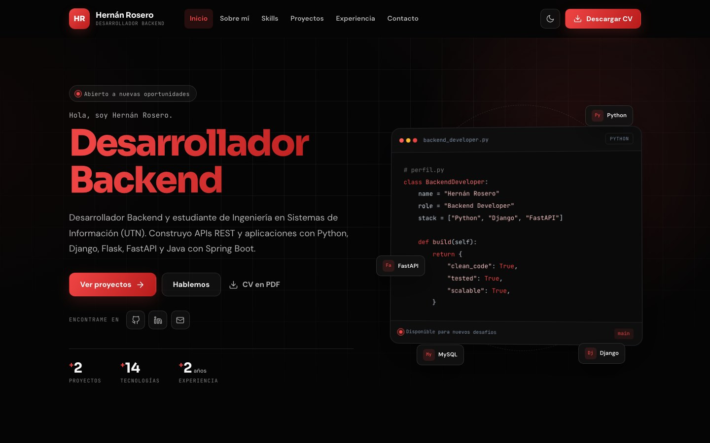
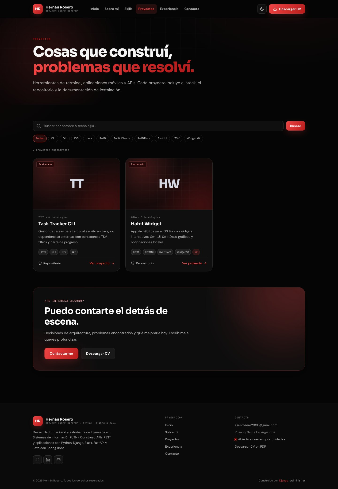
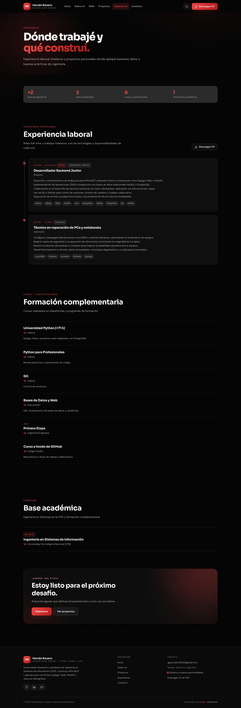
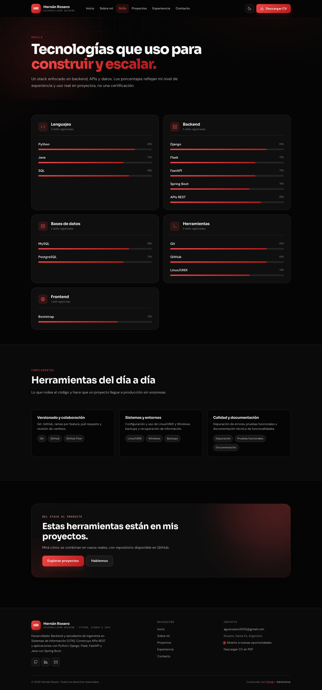
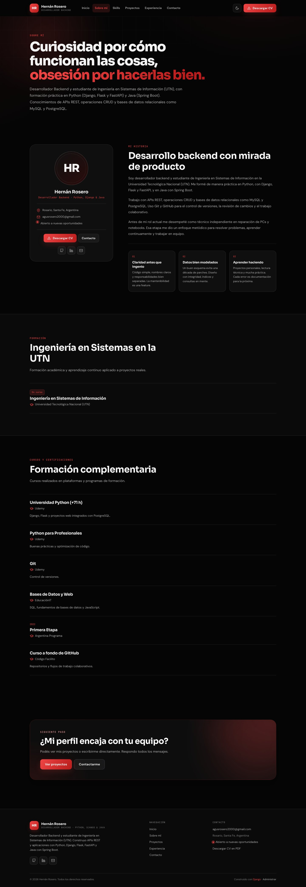
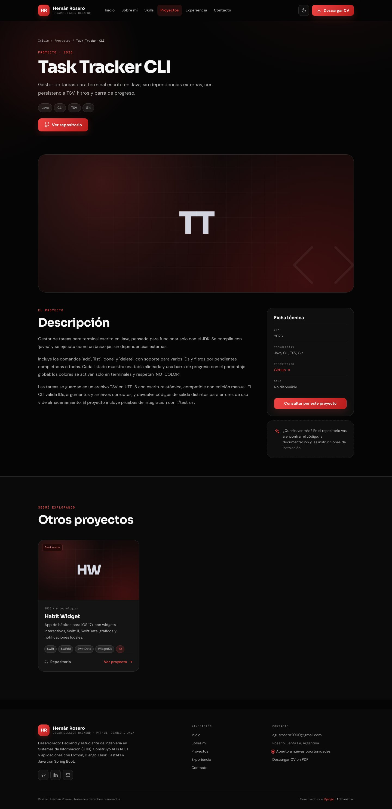
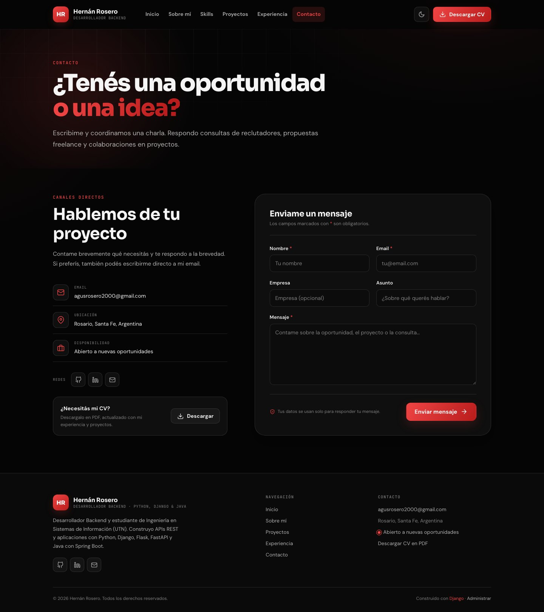
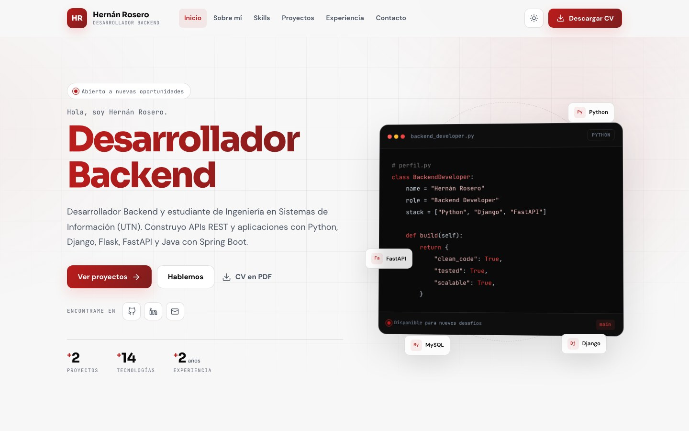

# Portfolio Backend · Django

Portfolio personal de **Hernán Rosero**, Desarrollador Backend y estudiante de
Ingeniería en Sistemas de Información (UTN).

Sitio construido con **Django 5.2**, HTML, CSS y JavaScript vanilla, con tema
claro/oscuro, diseño responsive, panel de administración y **CV en PDF generado
dinámicamente** desde la base de datos.



<p>
  
  
  
  
</p>

---

## Capturas

### Proyectos y experiencia

| Proyectos | Experiencia |
| --- | --- |
|  |  |

### Skills y sobre mí

| Skills | Sobre mí |
| --- | --- |
|  |  |

### Detalle de proyecto y contacto

| Detalle de proyecto | Contacto |
| --- | --- |
|  |  |

### Tema claro y responsive

| Tema claro | Vista móvil |
| --- | --- |
|  |  |

> Las capturas fueron tomadas del sitio real en funcionamiento.

---

## Funcionalidades

- **Inicio**: presentación, stack destacado, proyectos y experiencia reciente.
- **Sobre mí**: biografía, perfil profesional, formación académica y cursos.
- **Skills**: habilidades agrupadas por categoría, con nivel y barras animadas.
- **Proyectos**: listado con búsqueda, filtro por tecnología y página de detalle.
- **Experiencia**: trayectoria laboral y formación complementaria en formato timeline.
- **Contacto**: formulario validado con honeypot anti-spam y límite de envíos por sesión.
  Los mensajes quedan guardados en el panel y se puede configurar una notificación por email.
- **CV descargable**: PDF generado al vuelo con perfil, skills, experiencia,
  proyectos, formación y certificaciones.
- **Panel de administración**: perfil único, skills, proyectos, experiencia,
  formación, cursos y bandeja de mensajes.
- **Extras**: tema claro/oscuro persistente, navegación responsive, animaciones al
  hacer scroll, SEO básico, página 404 personalizada y accesibilidad (skip link,
  focus visible, labels, `aria-*`).

## Stack

- Python 3.11 – 3.13 (recomendado 3.11)
- Django 5.2
- SQLite por defecto (MySQL opcional)
- Pillow (imágenes de perfil y proyectos)
- ReportLab (CV en PDF)
- WhiteNoise (archivos estáticos en producción)
- HTML, CSS y JavaScript vanilla (sin frameworks de frontend)

### Contenido del portfolio

- **Perfil**: Hernán Rosero · Desarrollador Backend · Rosario, Santa Fe, Argentina.
- **Skills**: Python, Java, SQL; Django, Flask, FastAPI, Spring Boot, Bootstrap;
  MySQL, PostgreSQL; Git, GitHub, Linux/UNIX.
- **Experiencia**: Desarrollador Backend Junior en Deepyze y técnico independiente
  en reparación de PCs y notebooks.
- **Formación**: Ingeniería en Sistemas de Información (UTN, en curso).
- **Cursos**: Udemy, EducaciónIT, Argentina Programa y Código Facilito.
- **Proyectos**:
  - [Task Tracker CLI](https://github.com/hernan-r/task-tracker) — gestor de tareas
    para terminal en Java, sin dependencias externas.
  - [Habit Widget](https://github.com/hernan-r/habit-widget) — app de hábitos para
    iOS 17+ con SwiftUI, SwiftData y widgets interactivos.

---

## Puesta en marcha

```bash
# 1. Crear y activar el entorno virtual
python3.11 -m venv .venv
source .venv/bin/activate        # Windows: .venv\Scripts\activate

# 2. Instalar dependencias
pip install -r requirements.txt

# 3. Configurar variables de entorno (opcional en desarrollo)
cp .env.example .env

# 4. Aplicar migraciones (incluye el contenido inicial)
python manage.py migrate

# 5. Crear tu usuario administrador
python manage.py createsuperuser

# 6. Levantar el servidor
python manage.py runserver
```

Abrí:

- Sitio: <http://127.0.0.1:8000/>
- Panel: <http://127.0.0.1:8000/admin/>

> Las migraciones `core/0002_seed_content.py` y `core/0005_real_content.py`
> cargan el contenido inicial basado en el CV. Podés ajustar o reemplazar esos
> datos desde el panel de administración.

---

## Personalizar el portfolio

Ingresá al panel con tu superusuario. Vas a encontrar:

| Sección | Para qué sirve |
| --- | --- |
| **Perfil** | Nombre, titular, foto, biografías, contacto, redes, años de experiencia y resumen del CV. Es un registro único. |
| **Skills** | Nombre, categoría, nivel (0–100), orden y si se destaca en el inicio. |
| **Proyectos** | Título, slug, año, descripciones, tecnologías (separadas por comas), imagen, repo, demo, destacado y publicado. |
| **Experiencia** | Rol, empresa, tipo (laboral/freelance/personal), fechas, viñetas, stack y enlace. |
| **Formación** | Institución, título, fechas, descripción y si está en curso. |
| **Cursos y certificaciones** | Curso, institución, año, descripción y enlace. |
| **Mensajes de contacto** | Bandeja de entrada. Podés marcar como leídos/no leídos. |

### Imágenes

- Foto de perfil: se sube en **Perfil**. Si no hay foto se muestra un monograma.
- Portada de proyecto: se sube en **Proyectos**. Si no hay imagen se genera una
  portada con gradiente y las iniciales del proyecto.
- Los archivos se guardan en `media/` durante el desarrollo.

### CV en PDF

El botón **Descargar CV** apunta a `/cv/`. El PDF se arma en el momento con
ReportLab usando:

- Datos de contacto y resumen del perfil.
- Skills agrupadas por categoría.
- Experiencia laboral y freelance.
- Proyectos publicados.
- Formación académica y cursos/certificaciones.

El archivo se descarga como `CV-hernan-rosero.pdf`. No hay que subir ni actualizar
ningún PDF a mano: cambiás los datos en el panel y el próximo download ya refleja
los cambios.

---

## Contacto y email

Por defecto, Django usa el backend de consola: los emails se imprimen en la
terminal donde corre `runserver`. El mensaje **siempre** queda guardado en
**Mensajes de contacto** del panel.

Para recibir notificaciones reales, configurá en `.env`:

```env
EMAIL_BACKEND=django.core.mail.backends.smtp.EmailBackend
EMAIL_HOST=smtp.tuproveedor.com
EMAIL_PORT=587
EMAIL_HOST_USER=tu-usuario
EMAIL_HOST_PASSWORD=tu-password
EMAIL_USE_TLS=True
DEFAULT_FROM_EMAIL=Portfolio <no-reply@tudominio.com>
CONTACT_NOTIFICATION_EMAIL=tu@email.com
```

El formulario incluye:

- Validación de nombre, email y mensaje (mínimo 20 caracteres).
- Campo honeypot oculto para bots.
- Límite de un envío cada 30 segundos por sesión.
- Guardado de IP para trazabilidad básica.

---

## Base de datos MySQL (opcional)

El proyecto usa SQLite por defecto. Para MySQL, instalá el driver y configurá
las variables:

```bash
pip install mysqlclient
```

```env
DB_ENGINE=mysql
DB_NAME=portfolio
DB_USER=root
DB_PASSWORD=tu-password
DB_HOST=127.0.0.1
DB_PORT=3306
```

Después ejecutá `python manage.py migrate`.

---

## Tests

```bash
python manage.py test
```

La suite cubre modelos (singleton del perfil, slugs, iniciales), vistas públicas,
búsqueda/filtros, descarga del PDF, formulario de contacto, honeypot y rate limit.

---

## Estructura

```text
config/                 Configuración y URLs del proyecto
core/
  models.py             Perfil, formación, cursos, skills, proyectos, experiencia, mensajes
  views.py              Vistas públicas y descarga del CV
  forms.py              Formulario de contacto
  admin.py              Panel de administración personalizado
  utils.py              Generación del PDF con ReportLab
  migrations/           Esquema + contenido inicial
  tests.py              Tests automatizados
templates/
  base.html             Layout, navegación, footer y toasts
  core/                 Páginas del sitio
  partials/             Tarjetas, skills, iconos y redes
static/
  css/styles.css        Diseño responsive con tema claro/oscuro
  js/main.js            Tema, menú móvil, animaciones, toasts
docs/
  screenshots/          Capturas usadas en este README
media/                  Imágenes subidas desde el panel
```

### Rutas principales

| Ruta | Vista |
| --- | --- |
| `/` | Inicio |
| `/sobre-mi/` | Sobre mí + formación |
| `/skills/` | Skills por categoría |
| `/proyectos/` | Proyectos con búsqueda y filtros |
| `/proyectos/<slug>/` | Detalle del proyecto |
| `/experiencia/` | Experiencia y formación complementaria |
| `/contacto/` | Formulario de contacto |
| `/cv/` | Descarga del CV en PDF |
| `/admin/` | Panel de administración |

---

## Despliegue (resumen)

1. Creá un `.env` de producción con `DJANGO_DEBUG=False`, una `DJANGO_SECRET_KEY`
   nueva y `DJANGO_ALLOWED_HOSTS=tudominio.com`.
2. Ejecutá `python manage.py collectstatic`.
3. Serví la app con Gunicorn (o similar) detrás de Nginx:

   ```bash
   pip install gunicorn
   gunicorn config.wsgi:application
   ```

4. WhiteNoise ya está configurado para servir los estáticos.
5. Serví `media/` desde Nginx o un storage externo.
6. Configurá HTTPS y actualizá `DJANGO_CSRF_TRUSTED_ORIGINS` si corresponde.
7. Programá backups de la base de datos.

> Para producción se recomienda PostgreSQL o MySQL en lugar de SQLite.

---

## Licencia

Proyecto personal de uso libre. Adaptalo a tu perfil.
